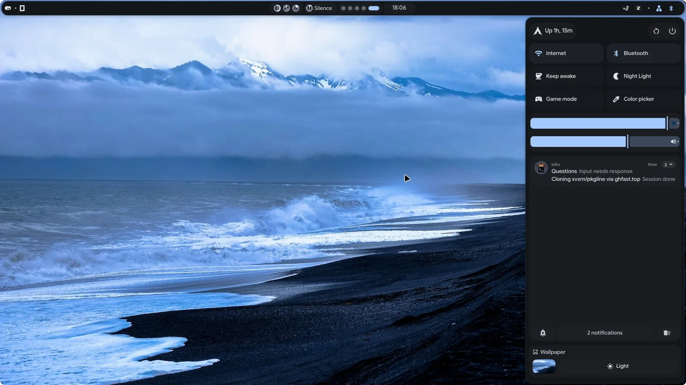

# dotfiles



**Under development. Not tested.**

Hyprland + Quickshell on Arch. A MangoWM port is parked in `extras/mango/`, not installed.

```sh
git clone https://github.com/vxrn0/dotfiles ~/dotfiles && ~/dotfiles/extras/install.sh
```

`extras/install.sh` has a preflight (`--check`), a plan mode (`--dry-run`) and `extras/verify.sh`
checks the result. None of it has been run on a clean machine.

`AGENTS.md` has the layout and the rules.

## Credit

A heavily modified fork of [end-4/dots-hyprland](https://github.com/end-4/dots-hyprland), GPL-3.0.
The upstream authors keep their copyright; renamed code is still derived code, so the license applies.
See [LICENSE](https://github.com/end-4/dots-hyprland/blob/main/LICENSE).

Personalized and maintained by **vxrn**, 2026.
